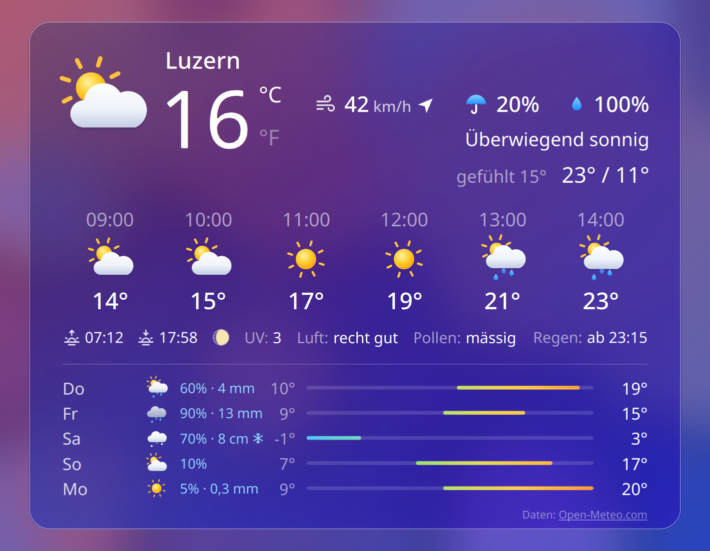

# Tux-Wetter

Wetter im Glas-Look für KDE Plasma 6: aktuelle Lage, Stundenwerte, 5-Tage-Vorschau und Wetterwarnungen.

**Datenanbieter:** Open-Meteo, MET Norway, Deutscher Wetterdienst, OpenWeatherMap oder WeatherAPI.com

## Programmvorschau

## Funktionen

**Anzeige** – alles auf einer Karte
- Aktuelles Wetter mit großem Symbol, Temperatur und Wetterlage in Worten; dazu Tageshoch/-tief, Regenwahrscheinlichkeit, Luftfeuchtigkeit und Wind
- Die nächsten 6 Stunden und 5-Tage-Vorschau mit Temperaturbalken (cyan = kühl bis orange = warm)
- Eigene Tag- und Nacht-Symbole; °C/°F per Klick auf der Karte

**Animierte Symbole** (auf Wunsch abschaltbar)
- Sich drehende Sonnenstrahlen, leuchtender Mond mit funkelnden Sternen in klaren Nächten
- Sanft treibende Wolken; Regen, Schauer und Schnee fallen aus der Wolke, Blitze zucken bei Gewitter

**Wetterwarnungen**
- Warnungen in vier Stufen nach Vorbild des DWD: Wind, Gewitter, Starkregen, Schnee, Glätte/Frost, Hitze
- Amtliche Warnungen von DWD, MeteoSchweiz und GeoSphere Austria plus Windböen weltweit
- Farbiges Warnband, ausführliche Tooltips, Desktop-Benachrichtigungen und Klick-Link zur amtlichen Warnseite; Warndreieck zeigt auch Warnungen an anderen Orten der Liste

**Infozeile** (jeder Wert mit Tooltip)
- Sonnenauf- und -untergang, UV-Index, Luftqualität nach Europäischem Index, Pollen (Europa)
- Regen der nächsten 2 Stunden, gemessene Temperatur der nächsten Wetterstation, gefühlte Temperatur, Mondphase
- Regenmenge und Neuschnee pro Tag; Klick auf einen Tag zeigt seine Temperaturkurve über 24 Stunden

**Wetteranbieter** – freie Wahl der Quelle
- Ohne Konto: Open-Meteo (voreingestellt, sechs Modelle u. a. ICON, ECMWF IFS, GFS), MET Norway (yr.no), DWD (MOSMIX)
- Mit kostenlosem Schlüssel: OpenWeatherMap, WeatherAPI.com
- Weltweite Ortssuche (findet auch „Zuerich“, Postleitzahlen, „Luzern (CH)“), Ortsliste mit mehreren Orten im selben Widget, Standort automatisch per IP

**Aussehen**
- Glas-Look mit verschwommen durchscheinendem Hintergrund, auch als deckende oder helle Karte
- Acht Farbvarianten plus eigene Farben mit Vorschau
- Kleine Anzeige in der Leiste mit Symbol und Temperatur – ein Klick öffnet die ganze Karte

**Zuverlässig im Hintergrund**
- Sofort Werte nach dem Anmelden (aus dem Zwischenspeicher), automatische Wiederholungsversuche ohne Netz
- Einstellungen werden gesichert und einem neu hinzugefügten Widget zum Übernehmen angeboten
- Deutsch oder Englisch (automatisch nach Systemsprache oder fest); Hinweis auf neue Versionen mit Link zur Download-Seite

## Installation

1. die `Veröffentlichung.zip` vom [neuesten Release](../../releases/latest) entpacken
2. `Tux-Wetter-installieren.sh` ausführen – oder die `.plasmoid`-Datei über *Einstellungen → Arbeitsfläche & Bildschirme → Miniprogramme beziehen → Von Datei installieren* einsetzen
3. In den Miniprogramm-Einstellungen Ort und Wetterdienst eintragen; für OpenWeatherMap/WeatherAPI den persönlichen Schlüssel dort ins Feld schreiben (nie in den Code)

Ausführliche Anleitung: [Anleitung-2-Ausfuehrlich.md](Programm/Anleitung-2-Ausfuehrlich.md)

## Ähnliche Projekte & Forks

- [TuX-Wetter für Cinnamon](https://github.com/19nkn80/Tux-Wetter-Cinnamon) – Fork von [19nkn80](https://github.com/19nkn80): eigenständiges Wetter-Desklet für Cinnamon 6.6 und neuer (z. B. Linux Mint), ohne KDE-Abhängigkeiten und ohne API-Schlüssel nutzbar

Lizenz: GPL-3.0-or-later
